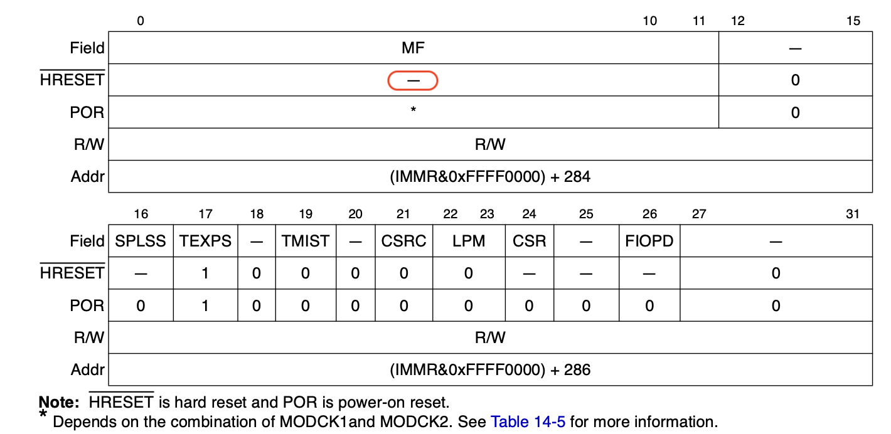

# TDS3000B Clock Doubling

TDS3000 oscilloscopes have a CPU that runs at 50 MHz. The TDS3000B version
CPU runs at 100 MHz.

You can see this in the VxWorks console when powering up:

```
UUUUUUUUUUUUUUUUUUUU
Loading Image
Boot flash checksum OK
Code flash checksum OK
0x00800000 bytes of RAM found
DRAM address line check OK
DRAM data line check OK
NVRAM address line check OK
NVRAM data line check OK
TBC ACQ SRAM address line check OK
TBC ACQ SRAM data line check OK
TBC Display SRAM address line check OK
TBC Display SRAM data line check OK
SuperI/O ID 0x000000b2
Uncompressing code from 0xffc40010 size 0x00000369
Enabling cache
Entering usrRoot
Enabling the MMU
sysClkRateSet using 50 MHz          <<<<<<<<<<<<<<<
Enabling I/O system
excInit called
Class 17 Level 3  hwResetTBC(): Installing Machine Check Exception handler. 05:35:57 11/07/2026 (thread: StartUp)
TBC reset count = 2
 Doubling core clock ... complete   <<<<<<<<<<<<<<<
 Attaching network interface qu0... done.
Attaching network interface lo0... done.
```

The both decision to set the clock at 50 MHz (up from the 25 MHz XTAL 
frequency on the motherboard) and then again to 100 MHz is based on a 
hardware ID that consists of IOs PD[3:5] of the MPC860 that are sampled
after coming out of reset, just like the pins that enable chatty VxWorks
diagnostics or indicate that there's an expandion card present.

I've looked for MPC860 datasheets and couldn't find any official SKU that
supports a 100 MHz CPU. The MPC860 in my TDS3014B is a  <FILL IN> that
goes up to 80 MHz. It looks like Tektronix uses overclocked version,
Freescale probably provided them with binned parts.

Anyway... there are no issues with this.

Except when you order an HRESET over BDM. On a TDS3000, this just works,
but on a TDS3000B, you might see an exception, like this:

```
UUUUUUUUUUUUUUUUUUUU
Loading Image
Boot flash checksum OK
Code flash checksum OK
0x00800000 bytes of RAM found
DRAM address line check OK
DRAM data line check OK
NVRAM address line check OK
NVRAM data line check OK
 *** Machine Check during line check at 0x03600008 ***
 *** Machine Check during line check at 0x03600008 ***
 *** Machine Check during line check at 0x03500008 ***
 *** Machine Check during line check at 0x03500008 ***
SuperI/O ID 0x000000b2
Uncompressing code from 0xffc40010 size 0x00000369
Enabling cache
Entering usrRoot
Enabling the MMU
sysClkRateSet using 50 MHz
Enabling I/O system
excInit called
Class 17 Level 3  hwResetTBC(): Installing Machine Check Exception handler. 05:55:32 11/07/2026 (thread: StartUp)

machine check
Exception next instruction address: 0x0026b7ec      <<<<<<<<<<<<<<<<<<
Machine Status Register: 0x0000b032
Condition Register: 0x240000lass 17 Level 3  hwOnBusErr(): Machine Check Exception - Rebooting...  vecNum 512 05:55:33 11/07/2026 (thread: StartUp)
cacheDisable (0);
Calling romInitUUUUUUUUUUUUUUUUUUUU
Loading Image
Boot flash checksum OK
Code flash checksum OK
...
Enabling the MMU
sysClkRateSet using 50 MHz
Enabling I/O system
excInit called
Class 17 Level 3  hwResetTBC(): Installing Machine Check Exception handler. 05:55:39 11/07/2026 (thread: StartUp)
TBC reset count = 1
 Doubling core clock ... complete
```

It doesn't always happen, and when it happens the scope recovers by restarting
the boot process again, but it's not acceptable if you want to eventually
use the BDM port to connect, say, GDB to the scope.

It took me a while to figure the root cause: it's the clock doubling. HRESET
doesn't touch a number of PLL configuration bits, including the MF field of
the PLPRCR register which controls the PLL feedback divider. This field that 
gets programmed from 0 to 1 to double the CPU clock speed.

Figure 14-16 of the User Manual look like this:



The dash circled in red tells us that the HRESET does not touch MF.

The problem is that the firmware has a bunch of other timings that
depend on the CPU clock speed; external bus wait cycles is one of 
them. So if you reset the CPU and start the firmware from scratch, 
the CPU keeps running at 100 MHz but the wait cycles are programmed
assuming it's running at 50 MHz and bad thing happen.

The solution is to program MF back to 0 when the CPU is still halted
after HRESET. `bdm_restore_boot_clock()` does that for us, and once
it's enabled you can safely issue an HRESET and the scope boots
as if there had been a cold power cycle.

You can see this boot clock action at work in the VxWorks console:

```
>>> enable_boot_diagnostics():
>>> Setting PBDAT watchpoint.
>>> bdm_restore_boot_clock():
>>> Boot clock: PLPRCR=0x0010c000 SCCR=0x21800000. Restoring single rate.
>>> Boot clock restored: PLPRCR=0x00008000 SCCR=0x21800000; PLL multiplier=1.
>>> Waiting for PBDAT watchpoint hit.
>>> R3=0x00004cb4, PB[19]=0
>>> PB[19] successfully cleared!
>>> CS7 card ID read: 0x48
>>> Card ID overridden to 0x00 (TDS3VM).
UUUUUUUUUUUUUUUUUUUU
Loading Image
Boot flash checksum OK
Code flash checksum OK
...
```


